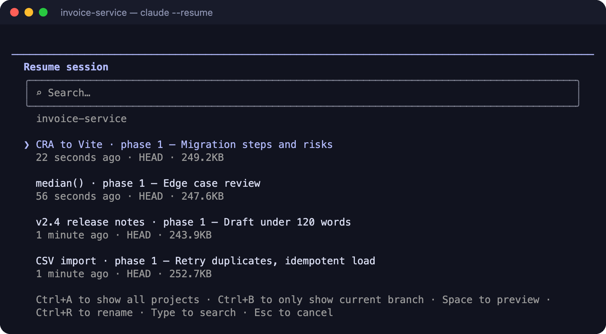

<p align="center"></p>

# Chat Naming

Short, consistent titles for your AI coding chats, written from the agent's own understanding of the task. One naming core, packaged for each agent app it can work with: Claude Code, Codex Desktop and OpenCode today.

```
Invoice API retries · phase 1 — Duplicates vs idempotency
Invoice API retries · phase 2 — Backfill script
Release notes · phase 1 — Draft v2.4 under 120 words
```


<sub>A real Claude Code session with Chat Naming, sped up; three short follow-up answers are cut from the middle.</sub>

Later, the titles are what you see when you look for a chat again:



## Why

Agent apps title a chat from its first message, or not at all. After a week you have a sidebar of "Fix bug", "Help me with this" and "Untitled". Chat Naming asks the agent you are already talking to for a stable topic and a short focus, adds a phase number, and applies the title with the app's own rename function.

- **No extra model call.** The agent that already understands your task proposes the title as part of its normal turn.
- **Stable topics, numbered phases.** A continuation of the same work gets the next phase number; a change of focus keeps the topic and phase.
- **Your titles win.** A title you set yourself is never overwritten: automatic naming freezes for that chat.
- **Local only.** A small ledger on your machine keeps topics and phases. Nothing is sent to Pellucid Studio or anyone else.

## Supported apps

| App | Status | How it works | Install |
| --- | --- | --- | --- |
| **Claude Code** | Ready, 0.2.1 | A Claude Code mod with a local Node.js core; applies titles with `/rename` | [plugins/claude-code](plugins/claude-code) |
| **Codex Desktop** (macOS) | Ready, 0.2.1 | Skills that use Codex Desktop's built-in title action; setup window, on-request or automatic mode | [plugins/codex-desktop](plugins/codex-desktop) |
| **OpenCode** | Preview, 0.1.0 | An OpenCode plugin that writes titles through the session API and reads them back | [plugins/opencode](plugins/opencode) |
| **Codex CLI** | In development | Hooks and a local MCP server; working in our tests, being repackaged as readable source | — |
| **Antigravity** | Not supported yet | Antigravity has no way for a plugin to set a chat title (checked on `agy` 1.5.14) | — |

## Quick install

**Claude Code** (2.1.275 or later), in a session:

```
/plugin install pellucid-chat-naming --marketplace Pellucid-Studio/chat-naming
```

**Codex Desktop** (macOS), with the Codex CLI (bundled with the app or installed on its own), then choose **Setup** in Codex Desktop:

```sh
codex plugin marketplace add Pellucid-Studio/chat-naming
codex plugin add pellucid-chat-naming@pellucid
```

One repository serves both apps: Claude Code reads `.claude-plugin/marketplace.json` and installs [`plugins/claude-code`](plugins/claude-code); Codex reads `.agents/plugins/marketplace.json` and installs [`plugins/codex-desktop`](plugins/codex-desktop).

**OpenCode**: from a copy of [`plugins/opencode`](plugins/opencode):

```sh
python3 install.py install --config-dir ~/.config/opencode
```

Each folder's README has the details: requirements, settings, what runs and what is stored.

## The title format

`Topic · phase N — focus`, up to 60 characters. Russian titles use `фаза`. A subtask is `Topic · focus`. Topics stay literal, so the same work keeps the same name across chats. Handoff notes connect a new chat to the previous one as its next phase, a branch or a subtask; no chat is ever created automatically.

## Privacy

Every edition runs locally. None of them makes network requests of its own, calls a model of its own or sends data to a third party. Each keeps a local ledger of chat ids, topics, phases and titles in a private folder of its app's profile; uninstalling leaves it in place for you to delete. The per-edition READMEs list exactly what each one reads and writes. Product page, privacy and support: [pellucid.studio/chat-naming](https://pellucid.studio/chat-naming/).

## Contributing and security

Bug reports and ideas are welcome; see [CONTRIBUTING.md](CONTRIBUTING.md). Report security problems privately as described in [SECURITY.md](SECURITY.md). Release history is in [CHANGELOG.md](CHANGELOG.md).

Chat Naming is built by Pellucid Studio together with AI agents: Claude, Codex and Gemini wrote, reviewed and tested parts of it. It is not affiliated with or endorsed by Anthropic, OpenAI, Google or the OpenCode project.

## License

MIT; see [LICENSE](LICENSE).
