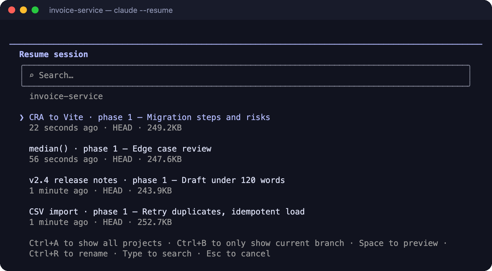

# Chat Naming for Claude Code

Chat Naming gives each Claude Code session a short, readable title such as `Release pipeline · phase 1 — Roll back failed deploys`. The title comes from the main agent's own understanding of your first real request, so the plugin makes no extra model call. A title you set yourself is never overwritten.



The `claude --resume` picker after four real sessions with the plugin installed. Each title was written by the plugin from the first request.

## Install

In Claude Code 2.1.275 or later, install it in one step:

```
/plugin install pellucid-chat-naming --marketplace Pellucid-Studio/chat-naming
```

On an older Claude Code, add the marketplace first, then install:

```
/plugin marketplace add Pellucid-Studio/chat-naming
/plugin install pellucid-chat-naming@pellucid
```

The same commands work in a terminal as `claude plugin …`. The plugin needs Node.js 22.13 or later on your `PATH` (see Requirements). Start a new session after installing. To update later, run `/plugin marketplace update pellucid`.

## How it works

1. On your first ordinary prompt in an untitled session, the plugin adds one short instruction to that turn. It asks the agent to call the plugin's `set_chat_title` tool with a topic, a focus and a language marker, and to keep working on your task.
2. After the agent's answer ends, the plugin applies the title with Claude Code's built-in `/rename` command.
3. On the next session event, the plugin compares the title Claude Code reports with the title it wrote and records the result as verified, failed or conflicting.
4. If you rename the session yourself with `/rename`, the plugin freezes automatic naming for that session. `/chat-naming unfreeze` adopts your title as the new baseline.
5. When the focus of the work changes substantially, the agent may update the focus. The topic and phase number stay the same.

Greetings, one-word replies and slash commands do not trigger naming. Sessions that already have a title are left alone.

The first time the agent calls `set_chat_title`, Claude Code asks you to allow it, like any other tool. Choose **Yes, and don't ask again**, or add the rule yourself in your settings, so naming runs on its own from then on:

```json
{ "permissions": { "allow": ["mcp__pellucid-chat-naming__set_chat_title"] } }
```

The plugin never allows the tool on your behalf: your permission rules and mode decide. It refuses calls from subagents. In an SDK or stream-json session without that allow rule the call is refused and the session stays untitled.

## Commands

- `/chat-naming status`: shows whether naming is active, the Node.js runtime it found and the state of this session.
- `/chat-naming freeze` and `/chat-naming unfreeze`: stop or resume automatic naming for this session.
- `/chat-naming handoff [continuation|branch|subtask]`: prints one line to paste into a new session so that it continues the same topic as the next phase, a branch or a subtask. No session is created automatically.

## Settings

The plugin asks for three optional values when you install it:

- **Naming state directory**: where the plugin keeps its local ledger. Leave it empty to use `pellucid-chat-naming` inside your Claude configuration directory (`~/.claude`, or `%USERPROFILE%\.claude` on Windows). The environment variable `CHAT_NAMING_STATE_DIR` overrides it.
- **Rename in Claude Desktop sessions**: off by default, because title behavior in the Claude desktop app's Code tab is not verified.
- **Answers between focus updates**: how many completed answers must pass before the agent is invited to update the focus again. Default 3.

Set `CHAT_NAMING_DEBUG=1` to print diagnostic lines in the transcript.

## What it runs

The plugin is a Claude Code mod: `hooks/register.ts` and the files in `src/` run inside Claude Code. For every ledger operation it starts `node --no-warnings libexec/chat-naming-core.mjs --state-dir <state directory>` with one JSON request on standard input, and reads one JSON answer. At the first session event it runs the same file with `--probe` to check the Node.js version. `libexec/` contains readable JavaScript generated from the project's TypeScript sources with the types removed, and `libexec/sqlite.mjs` adapts Node's built-in `node:sqlite` module. Nothing is downloaded or installed.

## What the mod does inside Claude Code

The plugin directory asks mods to say plainly what they hook and run. Chat Naming:

- **Starts one program:** `node`, only to run its own bundled `libexec/chat-naming-core.mjs` (once with `--probe`, then once per ledger operation, as described above). It starts nothing else.
- **Runs one slash command itself:** `/rename <title>`, after an answer ends, to apply the staged title. It never runs other commands.
- **Hooks the permission check** for its own `set_chat_title` tool only: it refuses the call when a subagent makes it and otherwise passes the check on unchanged, so your rules decide. It never answers allow.
- **Serves its own tool after the permission check:** the `tool.run` hook for `set_chat_title` is the tool's implementation. It runs only once the call is allowed, returns a short text and touches no other tool.
- **Adds context to a prompt:** on your first ordinary prompt in an untitled session, and when a focus update is due, it appends one instruction line for Claude to that turn. The prompt you see is unchanged.
- **Reads prompts only to skip commands:** it checks whether each submitted prompt starts with `/`. The prompt text is not stored, logged or passed on.
- **Watches `/rename`:** a rename it did not make freezes naming for the session.
- **Reads environment variables** `HOME`, `USERPROFILE` (Windows), `CLAUDE_CONFIG_DIR`, `CHAT_NAMING_STATE_DIR` and `CHAT_NAMING_DEBUG`, only to find its state directory and turn on debug lines. It reads no credentials, keys or tokens.
- **Sends nothing out:** the only data that leaves the mod goes to the local `node` process above, over standard input, and to Claude Code's own `/rename`. Neither makes a network request.

## Data and privacy

- **No network access.** Neither the mod nor the local core makes network requests, and the plugin calls no model of its own. It does not send data to Anthropic, Pellucid Studio or any third party.
- **What it reads:** the session id, the working directory and project root, the current session title that Claude Code reports, and which surface draws the session. It sees the topic and focus that the agent passes to its tool. It does not read your files or the conversation transcript; of your prompts it checks only whether one starts with `/`.
- **What it writes:** the session title, through Claude Code's own `/rename` command, and a local SQLite ledger on your machine. The ledger holds session ids, topics, focus phrases, titles, phase numbers, handoff records and a SHA-256 hash of the project path. The directory is created with owner-only permissions (0700) and the file with 0600.
- **Retention:** the ledger stays until you delete it. Uninstalling the plugin does not delete it; remove the state directory yourself if you no longer want it.

## Requirements and limits

- Claude Code 2.1.325 or later, in an interactive session or in an SDK or stream-json session that keeps input open. One-shot `claude -p` runs are not supported, because the process can exit before the title is applied.
- Node.js 22.13 or later available as `node` on `PATH`. Without it the plugin stays silent and `/chat-naming status` says why.
- macOS, Linux and Windows. On Windows, install Node.js so that `node` works in a new terminal, then restart Claude Code.
- Claude Code offers no compare-and-set for titles. A rename made outside the session, for example in the desktop sidebar, between the plugin's last observation and its write can be overwritten.
- The directory lists plugins with a hooks module (a mod) for Claude Code only.

## Support

Questions and bug reports: [Chat Naming support](https://pellucid.studio/chat-naming/support/). Please do not include chat transcripts, credentials or private information.

## Contributing and security

Bug reports, ideas and pull requests are welcome; see [CONTRIBUTING.md](../../CONTRIBUTING.md). Report security problems privately as described in [SECURITY.md](../../SECURITY.md). Release history is in [CHANGELOG.md](../../CHANGELOG.md).

## License

Released under the MIT License; see [LICENSE](LICENSE).
